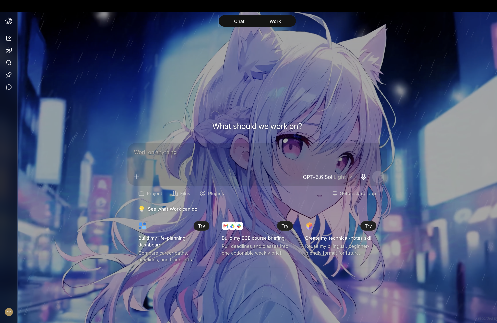

# ChatGPT Dynamic Glass Wallpaper

A userscript that adds a local image or video wallpaper and glass-style surfaces to the ChatGPT website. Version **1.9.8**. Unofficial; not affiliated with OpenAI.

为 ChatGPT 网页版添加本地图片／视频壁纸和毛玻璃效果。适用于 Tampermonkey 等 userscript 管理器，不是桌面端皮肤或 Codex Plugin。

## 效果预览

这张图保留自早期 1.9 版本，用于展示壁纸与透明界面的整体效果；不代表 1.9.8 在当前网页上的完整视觉验收。图中的壁纸不单独提供下载，安装后请选择自己的素材。

## 功能

- 本地图片或静音循环视频作为网页壁纸。
- 浏览器 IndexedDB 保存选择，刷新后自动恢复。
- 可调整亮度、模糊、饱和度和各区域透明度。
- 使用 DOM 观察器适配页面切换，不需要 API Key。

## 安装与使用

1. 安装可信来源的 Tampermonkey。
2. 在管理器中新建脚本，用本仓库的 `chatgpt-dynamic-glass-wallpaper.user.js` 完整替换默认内容并保存。
3. 只启用一份此脚本，打开或刷新 `https://chatgpt.com/`。
4. 点击“选择图片或视频壁纸”，选择自己的本地文件。
5. 换壁纸：macOS 按 **Option + Shift + W**；其他系统按 **Alt + Shift + W**。

亮度、模糊、透明度等参数在脚本顶部 `SETTINGS` 中调整。视频能否播放取决于浏览器支持的编码。禁用脚本后刷新即可恢复页面外观。

## Privacy / 隐私

- 本仓库包含代码、通用说明、校验值及一张检查过的历史效果图；不附带聊天记录、浏览器数据、本地配置或原始壁纸文件。
- 当前脚本没有分析统计、外部依赖、远程图片地址或发送网络请求的逻辑，不读取 Cookie 或登录凭据。
- 脚本会在本地检查页面元素和部分文本，以识别需要调整的界面区域；这些检查不发送或保存聊天内容。
- 选择的文件保存在 `chatgpt.com` 的 IndexedDB（`ChatGPTWallpaperDB`），并通过本地 `blob:` URL 显示。保存的是 File 对象，可能包含原始文件名及修改时间。从视频切换到图片时会保留上一段视频。
- 该存储受网站同源规则约束，不是加密或与网站隔离的保险箱；同源页面代码及具备相应权限的扩展可能访问它。请勿选择敏感私人素材。
- 禁用／卸载脚本不会自动删除已保存的壁纸。需要删除时，可在浏览器开发者工具的 Application → IndexedDB 中只删除 `ChatGPTWallpaperDB`。清除整个站点数据还可能退出登录。
- 代码审查不能保证浏览器、其他扩展、网站或未来版本的绝对安全。

## 兼容性与限制

ChatGPT 页面结构变化后可能需要更新 CSS。本次发布保留 1.9.8 的原有行为；没有重新执行所有页面的视觉回归。部分旧注释存在字符编码乱码，不影响 JavaScript 语法。内置 `pause()` 可能被自动恢复播放机制覆盖；需要停止运行时请禁用脚本并刷新。

## 校验

`SHA256SUMS` 提供发布脚本及预览图的 SHA-256；`PRIVACY-REVIEW.md` 记录本次静态检查范围。

## 技术结构与调试

脚本使用原生 JavaScript，按设置、媒体加载、页面样式和兼容处理分模块。通过 IndexedDB 存储用户选择的媒体，通过本地 Blob URL 显示；MutationObserver 与 ResizeObserver 用于适配动态页面。

在浏览器 Console 中，`ChatGPTWallpaper.status()` 可检查模块状态，`ChatGPTWallpaper.restart()` 可尝试恢复视频。`play()` 与 `pause()` 也可调用，但暂停可能被自动恢复机制覆盖。

## 项目状态

这是个人实验项目，使用 AI 辅助开发。当前推荐版本为 1.9.8；保留早期项目的效果展示和说明，但未导入旧仓库的 Git 历史。仓库尚未指定开源许可证。
